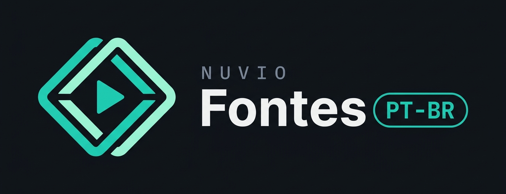

  

# Encerrando o Nuvio Fontes PT-BR

**28 de novembro de 2026**

Comecei o Nuvio Fontes PT-BR como um projeto pessoal: provedores para assistir a filmes, séries e animes dublados e legendados em português do Brasil no [Nuvio](https://github.com/tapframe/NuvioStreaming). Como ficou bom, resolvi abrir o código de graça para a comunidade.

Em 25 dias, o projeto foi muito além do que eu imaginava:

- 65 provedores funcionando
- mais de 450 sessões orquestrando diferentes agentes de IA, somando mais de 250 horas de execução
- quase 150 mudanças propostas no OpenSpec, entre investigação de provedores, melhorias de arquitetura e correções
- quase mil usuários únicos
- 27 estrelas e 7 forks no GitHub

São bons números para tão pouco tempo de vida.

Hoje descobri que parte desse trabalho está sendo usada em produtos pagos e de código fechado, sem me dar crédito e sem manter a licença. Tem gente cobrando de outras pessoas pelo acesso aos provedores que eu criei e mantinha de graça.

Eu escolhi a [GPL-3.0](https://www.gnu.org/licenses/gpl-3.0.html) sabendo bem o que ela permite. Uso comercial não é problema, desde que as condições sejam cumpridas: quem distribui o código, modificado ou não, precisa manter os avisos de autoria, usar a mesma licença e entregar o código-fonte para quem recebe o produto. Nada disso está acontecendo. Fica uma decepção grande ver a minha boa-fé sendo usada para outros lucrarem.

Isso cansa e tira a vontade de continuar. Não faz mais sentido gastar meu tempo livre mantendo tudo funcionando para ver meu código ser usado assim. Por isso, decidi encerrar o Nuvio Fontes PT-BR.

## O que muda

1. Retirei deste repositório o código, os provedores, os manifests e o gerador de manifest, e limpei o histórico.
2. Os manifests que você adicionou no Nuvio deixam de funcionar. Você já pode remover o repositório em **Configurações > Conteúdo e descoberta > Plugins**.
3. Não vou mais lançar versões novas, fazer correções nem dar suporte.

## Se você pagou para usar esses provedores

Sinto muito. Você pagou por algo que eu fiz para ser gratuito e aberto. Pela GPL-3.0, quem distribuiu esse produto para você tem a obrigação de entregar o código-fonte completo, sob a mesma licença. Você tem todo o direito de pedir isso.

## Obrigado

A todo mundo que usou o projeto, testou, avisou quando algo parava de funcionar, sugeriu fontes novas e contribuiu de boa-fé: obrigado de verdade. Foi por causa de vocês que valeu a pena manter o Nuvio Fontes PT-BR até aqui. Um agradecimento especial à galera do [r/nuvioptbr](https://www.reddit.com/r/nuvioptbr/), que abraçou o projeto desde o começo.

Um abraço,

Nathanael Ferreira
